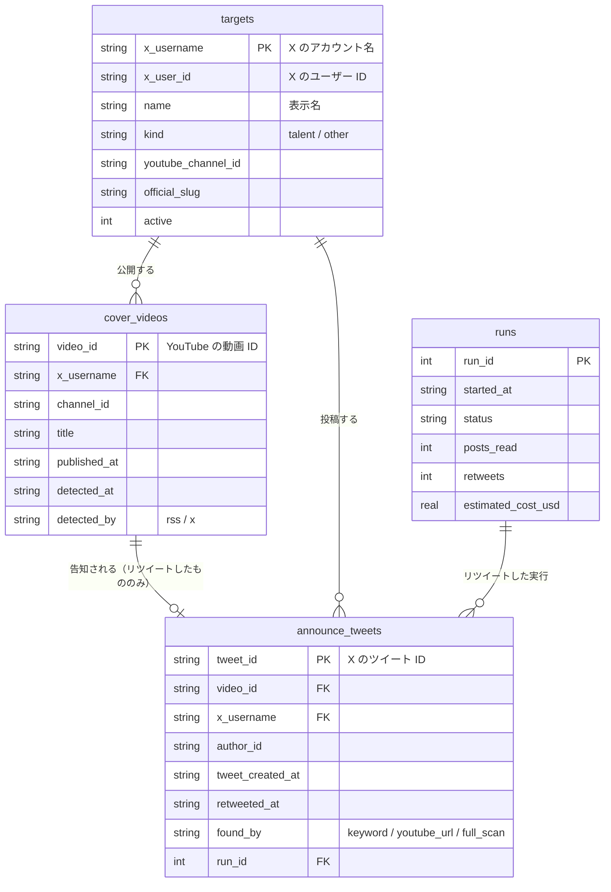

# データ設計

このプログラムが扱うデータを、処理より先にデータから整理したものです（データ中心アプローチ）。
「歌ってみた動画は YouTube で、その告知は X で把握する」という考え方に基づきます。

- 2026-11-22 作成（Phase 3 の実装時点）
- 2026-11-22 データベース（SQLite: `data/bot.db`）を追加

---

## 1. データの全体像

データは、**事実を表すデータ**（何が・いつ起きたか）と、**処理のためのデータ**（どこまで処理したか）に分けます。
事実を表すデータと実行記録はデータベースに、処理のためのデータは JSON に置きます。

| 区分 | No. | データ | 説明 | 情報源 | 保存先 |
|---|---|---|---|---|---|
| 事実 | ① | 対象者マスタ | 監視する人とアカウント | にじさんじ公式サイト、`following.json` | `bot.db` の `targets` |
| 事実 | ② | 歌ってみた動画 | 対象者が公開した歌ってみた動画 | YouTube（RSS）、X | `bot.db` の `cover_videos` |
| 事実 | ③ | 告知ツイート | ②を告知した本人のツイートのうち、**リツイートしたもの** | X（検索 API） | `bot.db` の `announce_tweets` |
| 処理 | ④ | 検索の進み具合 | 通常の検索をどこまで終えたか | このプログラム | `state.json` |
| 処理 | ⑤ | 告知探しの進み具合 | ②の動画ごとに、X をどこまで探したか（公開から 7 日間） | このプログラム | `youtube_watch.json` |
| 処理 | ⑥ | 保留候補 | 1 日の上限を超えて翌日に回した候補 | このプログラム | `pending.json` |
| 処理 | ⑦ | 実行記録 | 実行ごとの検索回数・読み取り件数・費用 | このプログラム | `bot.db` の `runs`（概要）<br>`observations/日付.json`（詳細） |



---

## 2. 事実を表すデータ

日時はすべて UTC の ISO 8601 文字列で保存します。

### ① 対象者マスタ（`targets`）

| 項目 | 型 | 必須 | 説明 |
|---|---|---|---|
| x_username | 文字列 | ○ | X のアカウント名（**主キー**）。検索クエリ `from:` に使う |
| x_user_id | 文字列 | | X のユーザー ID。リツイートした告知から分かったものだけ入る |
| name | 文字列 | | 表示名（公式サイトから） |
| kind | 区分 | ○ | `talent`（YouTube チャンネルあり）/ `other`（ユニット・公式アカウントなど） |
| youtube_channel_id | 文字列 | | YouTube のチャンネル ID。タレントのみ |
| official_slug | 文字列 | | 公式サイトのタレントページの識別子 |
| active | 0/1 | ○ | `following.json` に入っているか。外れても行は消さない（過去の記録とつなぐため） |
| updated_at | 日時 | ○ | 最後に更新した日時 |

- 毎回の実行で `following.json` と `youtube_channels.json` の内容を反映する
- 表示名と公式サイトの識別子は `build_youtube_channels.py` が入れる
- 注意：X のアカウント名は本人が変えられる。変わった場合は `following.json` を直す（古い名前の行は `active = 0` で残る）

### ② 歌ってみた動画（`cover_videos`）

| 項目 | 型 | 必須 | 説明 |
|---|---|---|---|
| video_id | 文字列 | ○ | YouTube の動画 ID（**主キー**） |
| x_username | 文字列 | | 公開した対象者（①への参照）。分からなければ空 |
| channel_id | 文字列 | | YouTube のチャンネル ID |
| title | 文字列 | | 動画のタイトル |
| published_at | 日時 | | RSS 上の公開日時。プレミア公開では、実際の公開時刻とずれることがある |
| detected_at | 日時 | ○ | 最初に記録した日時 |
| detected_by | 区分 | ○ | `rss`（YouTube の RSS で見つけた）/ `x`（告知ツイートから知った） |

- RSS から記録する対象：タイトルが歌ってみた（`YOUTUBE_COVER_TITLE_PATTERN`）に当たり、除外パターン（歌枠など）に当たらない、公開から 7 日以内の動画。ショートは除く
- RSS に出てこない動画（ユニットのチャンネルなど）も、リツイートしたら `detected_by = x` で記録する
- 一度記録した動画は消さない

### ③ 告知ツイート（`announce_tweets`、リツイートしたもののみ）

| 項目 | 型 | 必須 | 説明 |
|---|---|---|---|
| tweet_id | 文字列 | ○ | X のツイート ID（**主キー**） |
| video_id | 文字列 | ○ | 告知している動画（②への参照）。複数あるときは代表の 1 本 |
| x_username | 文字列 | | 投稿した対象者（①への参照）。②または①のユーザー ID から求める |
| author_id | 文字列 | | X のユーザー ID |
| tweet_created_at | 日時 | | 投稿日時（ツイート ID から求める） |
| retweeted_at | 日時 | | リツイートした日時（データベースを作る前の分は、実行の終了時刻または空） |
| found_by | 区分 | | 見つけた方法：`keyword`（通常の検索）/ `youtube_url`・`full_scan`（Phase 3）。不明なら空 |
| run_id | 整数 | | リツイートした実行（⑦への参照） |

- 1 本の動画につき、リツイートするのは 1 件まで（動画と告知は 1 対 0..1）
- **ツイートの本文は保存しない**（公開リポジトリのため）
- 対象者が分かったときに①へユーザー ID を覚え、同じユーザー ID の過去の記録の対象者もさかのぼって埋める

---

## 3. 処理のためのデータ

| No. | データ | 項目 | 使い方 |
|---|---|---|---|
| ④ | 検索の進み具合 | 前回の検索の終わり（UTC） | 次の実行は、その時刻から検索する |
| ⑤ | 告知探しの進み具合 | 動画 ID、どこまで探したか、告知が見つかったか | 同じ投稿を何度も読まない（費用対策）。公開から 7 日で消える |
| ⑥ | 保留候補 | ツイート ID、動画 ID、ユーザー ID、見つけた方法 | 翌日の実行で先にリツイートする |
| ⑦ | 実行記録 | 実行日時、検索回数、読み取り件数、リツイート数、費用 | 費用と取りこぼしの分析。詳細（検索ごと・投稿ごと）は `observations/` に残す |

このほか、二重リツイートを防ぐためのリツイート済みのツイート ID（`retweeted.json`）と
動画 ID（`retweeted_videos.json`）を JSON に置きます。③と内容が重なりますが、
Bot の判定はこれらの JSON を使い、データベースは記録だけに使います（データベースに問題があっても Bot は止まりません）。

---

## 4. 1 回の実行でのデータの流れ

| 順 | 処理 | 読む | 書く |
|---|---|---|---|
| 1 | 前回保留した候補を先に処理する | ⑥ | |
| 2 | X をキーワードと YouTube リンクで検索する | ①、④ | |
| 3 | YouTube の RSS から歌ってみたを見つける（Phase 3） | ① | ⑤ |
| 4 | 告知が見つかっていない動画について、X で本人の投稿を探す（Phase 3） | ⑤ | ⑤ |
| 5 | 候補を判定してリツイートする（上限を超えた分は保留） | リツイート済み ID | ⑥、リツイート済み ID |
| 6 | 検索の進み具合・観測記録を保存する | | ④、⑦（詳細） |
| 7 | データベースに記録する | | ①、②、③、⑦（概要） |

---

## 5. データベースの運用

- ファイル：`data/bot.db`（SQLite）。GitHub Actions の実行後に、JSON と一緒にリポジトリへコミットされる
- 作り方：`python init_database.py`（最初に 1 回。これまでの観測記録と `retweeted_videos.json` を取り込む）
- 表示名を入れる：`python build_youtube_channels.py`
- **ローカルで本番の実行（dry-run 以外）をしない**：`bot.db` はバイナリのため、GitHub Actions の更新とぶつかると自動でマージできない
- ファイルの中身は公開される。ツイートの本文や個人の情報は保存しない

### 集計の例

```sql
-- 対象者ごとのリツイート数
SELECT t.name, COUNT(*) FROM announce_tweets a JOIN targets t USING (x_username) GROUP BY t.name ORDER BY 2 DESC;

-- RSS で見つけたが、告知をリツイートしていない歌ってみた（取りこぼしの候補）
SELECT v.video_id, v.x_username, v.title, v.published_at
FROM cover_videos v LEFT JOIN announce_tweets a USING (video_id)
WHERE a.tweet_id IS NULL AND v.detected_by = 'rss';

-- 見つけた方法ごとの件数（Phase 3 の効果）
SELECT found_by, COUNT(*) FROM announce_tweets GROUP BY found_by;

-- 月ごとの推定費用
SELECT substr(started_at, 1, 7) AS month, ROUND(SUM(estimated_cost_usd), 3) FROM runs GROUP BY month;
```
